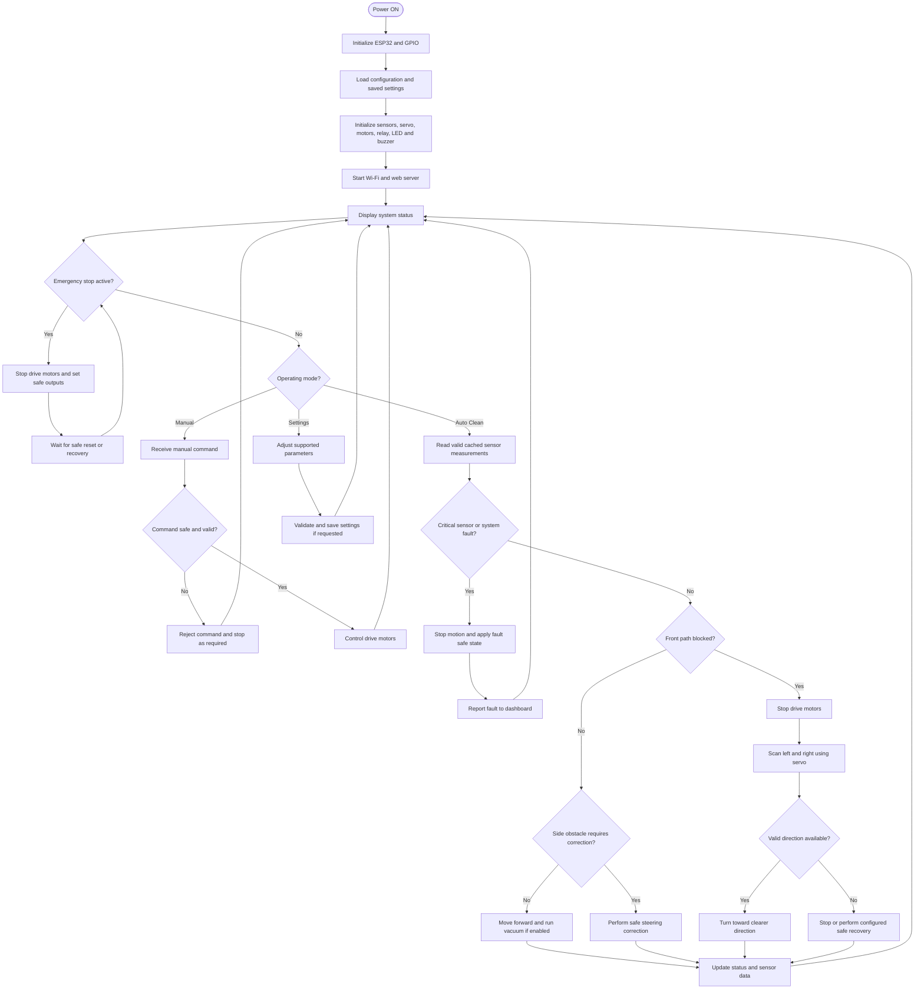

# ESP32 Smart Automatic Vacuum Cleaner

An ESP32-based smart robotic vacuum cleaner featuring Wi-Fi connectivity, a mobile-friendly web dashboard, manual driving, autonomous obstacle avoidance, ultrasonic distance sensing, servo scanning, and relay-controlled vacuum operation.

> **Project type:** Embedded Systems | Robotics | Internet of Things (IoT)  
> **Controller:** ESP32-WROOM-32  
> **Programming language:** C++ (Arduino framework)  
> **Project status:** Prototype / Development  
> **Primary function:** Autonomous vacuum cleaning with remote monitoring and control

---

## Table of Contents

1. [Project Overview](#1-project-overview)
2. [Project Objectives](#2-project-objectives)
3. [Features](#3-features)
4. [System Architecture](#4-system-architecture)
5. [Hardware Components](#5-hardware-components)
6. [GPIO Pin Configuration](#6-gpio-pin-configuration)
7. [Circuit Connections](#7-circuit-connections)
8. [Power Supply Design](#8-power-supply-design)
9. [System Flowchart](#9-system-flowchart)
10. [Obstacle Avoidance Algorithm](#10-obstacle-avoidance-algorithm)
11. [Software Requirements](#11-software-requirements)
12. [Firmware Installation](#12-firmware-installation)
13. [Wi-Fi and Mobile Dashboard](#13-wi-fi-and-mobile-dashboard)
14. [Operating Modes](#14-operating-modes)
15. [Safety and Error Handling](#15-safety-and-error-handling)
16. [Configuration Parameters](#16-configuration-parameters)
17. [Testing Procedure](#17-testing-procedure)
18. [Troubleshooting](#18-troubleshooting)
19. [Known Limitations](#19-known-limitations)
20. [Future Enhancements](#20-future-enhancements)
21. [Repository Structure](#21-repository-structure)
22. [Contributing](#22-contributing)
23. [Security Guidelines](#23-security-guidelines)
24. [License](#24-license)
25. [Acknowledgements](#25-acknowledgements)

---

## 1. Project Overview

The ESP32 Smart Automatic Vacuum Cleaner is an embedded robotics project designed to provide mobile-controlled and autonomous vacuum cleaning.

The ESP32 acts as the main controller. It manages the drive motors, ultrasonic sensors, servo motor, vacuum relay, rear infrared sensor, RGB status LED, buzzer, and browser-based dashboard.

The robot can be operated manually from a mobile phone or computer browser. In Auto Clean mode, the controller uses distance measurements to detect obstacles and select a possible direction for movement.

The web dashboard displays the robot's operating mode, motion state, vacuum state, sensor measurements, and Wi-Fi connectivity.

The current design focuses on **four-wheel drive and vacuum cleaning**. A brush motor and brush mechanism are not included in the current system.

### Project Goals

- Develop a Wi-Fi-enabled robotic vacuum cleaner using an ESP32.
- Provide remote manual control through a responsive web interface.
- Implement autonomous obstacle detection and avoidance.
- Monitor three ultrasonic sensors and a rear IR sensor.
- Scan the front area using an SG90 servo.
- Control the vacuum motor independently through a relay.
- Provide audible and visual status notifications.
- Implement sensor diagnostics and emergency-stop handling.
- Store supported configuration settings persistently where implemented.
- Build a modular platform that can be expanded in future versions.

---

## 2. Project Objectives

| Objective | Description |
|---|---|
| Embedded control | Use the ESP32 to manage sensors, motors, and system logic. |
| Wireless connectivity | Allow a phone or computer to access the robot over Wi-Fi. |
| Manual operation | Provide directional controls through a web dashboard. |
| Autonomous operation | Detect obstacles and choose an avoidance direction. |
| Distance measurement | Use three ultrasonic sensors for front, left, and right sensing. |
| Scanning mechanism | Use an SG90 servo to rotate the front sensor. |
| Vacuum control | Switch the vacuum motor using a relay. |
| Status indication | Use an RGB LED, buzzer, and dashboard messages. |
| Fault handling | Detect sensor errors and transition to a safe state. |
| Expandability | Allow future improvements to mapping, battery monitoring, and motion feedback. |

---

## 3. Features

### Core Hardware Features

- ESP32-WROOM-32 controller.
- Four-wheel drive chassis.
- L298N dual H-bridge motor driver.
- Four BO DC gear motors.
- Three HC-SR04 ultrasonic sensors.
- SG90 servo-mounted front ultrasonic sensor.
- Rear IR sensor.
- Relay-controlled vacuum motor.
- Common-cathode RGB status LED.
- Buzzer for audible alerts.
- 3S lithium-ion battery system with a suitable BMS.

### Firmware and Dashboard Features

- Manual mode.
- Auto Clean mode.
- Responsive mobile web dashboard.
- Wi-Fi connection diagnostics.
- Sensor status display.
- Servo scanning.
- Obstacle avoidance logic.
- Vacuum ON/OFF control.
- Emergency-stop command.
- Sensor fault reporting.
- Hardware diagnostics where implemented.
- Configurable control parameters.
- Persistent settings where implemented.
- Startup animation and browser sound where implemented.

> **Implementation note:** The feature list describes the intended system. Verify each feature against the exact firmware version committed to this repository before considering it tested or complete.

---

## 4. System Architecture

The system is divided into six major subsystems.

| Subsystem | Main Components | Responsibility |
|---|---|---|
| Controller | ESP32-WROOM-32 | Runs the firmware and coordinates the robot. |
| Drive system | L298N, four BO motors, wheels | Provides forward, reverse, and turning motion. |
| Obstacle detection | Three HC-SR04 sensors, rear IR | Measures nearby obstacles and provides rear safety information. |
| Scanning system | SG90 servo | Rotates the front sensor to inspect left and right. |
| Vacuum system | Vacuum motor, relay | Switches the vacuum motor ON or OFF. |
| User interface | Wi-Fi, web server, browser dashboard | Displays status and accepts user commands. |

### High-Level Block Diagram

```text
                    MOBILE PHONE / COMPUTER
                              |
                              | Wi-Fi
                              |
                    +--------------------+
                    | ESP32 Web Dashboard|
                    +--------------------+
                              |
                              v
                    +--------------------+
                    | ESP32-WROOM-32     |
                    | Main Controller    |
                    +--------------------+
                       |       |       |
          +------------+       |       +-------------+
          |                    |                     |
          v                    v                     v
   +-------------+     +---------------+     +---------------+
   | L298N Motor |     | Ultrasonic    |     | Vacuum Relay  |
   | Driver      |     | Sensors       |     |               |
   +-------------+     +---------------+     +---------------+
          |                    |                     |
          v                    v                     v
   Four Drive Motors     SG90 Servo Scan        Vacuum Motor

                       Additional Inputs/Outputs
                                 |
                   +-------------+-------------+
                   |             |             |
                   v             v             v
                Rear IR       RGB LED        Buzzer
```

---

## 5. Hardware Components

| No. | Component | Quantity | Purpose |
|---:|---|---:|---|
| 1 | ESP32-WROOM-32 development board, 38-pin | 1 | Main controller |
| 2 | L298N dual H-bridge motor driver | 1 | Drive motor control |
| 3 | BO DC gear motors | 4 | Wheel drive |
| 4 | Wheels | 4 | Robot movement |
| 5 | Chassis | 1 | Mechanical structure |
| 6 | 18650 lithium-ion cells | 3 | Main battery pack |
| 7 | 3S BMS | 1 | Battery protection |
| 8 | HC-SR04 ultrasonic sensors | 3 | Front, left, and right obstacle detection |
| 9 | SG90 servo motor | 1 | Front sensor scanning |
| 10 | Rear IR sensor module | 1 | Rear obstacle/safety detection |
| 11 | DC vacuum motor with impeller | 1 | Vacuum airflow |
| 12 | Two-channel relay module | 1 | Vacuum motor switching |
| 13 | Common-cathode RGB LED | 1 | Visual status indication |
| 14 | Buzzer module | 1 | Audible status notifications |
| 15 | Regulated 5 V supply or buck converter | As required | Logic and peripheral power |
| 16 | 12.6 V CC/CV 3S lithium-ion charger | 1 | Charging the battery pack |
| 17 | Fuse and holder | 1 | Overcurrent protection |
| 18 | Rocker switch | 1 | Main power control |
| 19 | Resistors | As required | LED limiting and ECHO voltage dividers |
| 20 | Capacitors | As required | Supply decoupling |
| 21 | JST connectors | As required | Modular wiring |
| 22 | Female headers | As required | PCB connections |
| 23 | Perfboard or custom PCB | 1 | Circuit assembly |
| 24 | Hook-up wire | As required | Electrical connections |
| 25 | Fasteners and mounting hardware | As required | Mechanical assembly |
| 26 | Filters and vacuum housing | As required | Dust collection and airflow management |

### Development Tools

- Computer running Windows, Linux, or macOS.
- Arduino IDE 2.x or compatible build environment.
- USB data cable.
- Digital multimeter.
- Soldering equipment.
- Mobile phone or computer browser.
- Optional oscilloscope or logic analyzer.

---

## 6. GPIO Pin Configuration

The following pin assignment is the documented project configuration. Compare it with the actual firmware before wiring the hardware.

| Function | ESP32 GPIO | Notes |
|---|---:|---|
| L298N ENA | GPIO 25 | Left-side PWM enable |
| L298N IN1 | GPIO 26 | Left-side motor direction |
| L298N IN2 | GPIO 27 | Left-side motor direction |
| L298N ENB | GPIO 14 | Right-side PWM enable |
| L298N IN3 | GPIO 16 | Right-side motor direction |
| L298N IN4 | GPIO 17 | Right-side motor direction |
| Front ultrasonic TRIG | GPIO 21 | Output |
| Front ultrasonic ECHO | GPIO 34 | Input-only; voltage divider required |
| Left ultrasonic TRIG | GPIO 33 | Output |
| Left ultrasonic ECHO | GPIO 35 | Input-only; voltage divider required |
| Right ultrasonic TRIG | GPIO 5 | Output; boot-strapping caution |
| Right ultrasonic ECHO | GPIO 36 / VP | Input-only; voltage divider required |
| SG90 servo signal | GPIO 18 | Servo control signal |
| Rear IR OUT | GPIO 39 / VN | Input-only |
| RGB LED red | GPIO 4 | Series resistor required |
| RGB LED green | GPIO 22 | Series resistor required |
| RGB LED blue | GPIO 23 | Series resistor required |
| Buzzer control | GPIO 32 | Verify module voltage and type |
| Vacuum relay control | GPIO 19 | Verify relay active logic |

### Important GPIO Notes

- GPIO 34, 35, 36, and 39 are **input-only**.
- GPIO 6–11 are normally connected to the module's SPI flash and should not be used for general-purpose signals.
- GPIO 0, 2, 5, 12, and 15 are boot-strapping pins.
- GPIO 5 is used for the right ultrasonic TRIG in this configuration. Verify that the connected circuit does not interfere with booting.
- Do not connect a 5 V signal directly to an ESP32 GPIO.
- Confirm the board's pin labels and actual GPIO numbers before connecting hardware.

---

## 7. Circuit Connections

### 7.1 ESP32 to L298N

| ESP32 Pin | L298N Pin | Function |
|---|---|---|
| GPIO 25 | ENA | Left motor PWM |
| GPIO 26 | IN1 | Left direction |
| GPIO 27 | IN2 | Left direction |
| GPIO 14 | ENB | Right motor PWM |
| GPIO 16 | IN3 | Right direction |
| GPIO 17 | IN4 | Right direction |
| GND | GND | Common logic ground |

Connect the left and right motors to the corresponding output channels after verifying the actual motor-driver module and motor current.

If PWM is used on ENA and ENB, remove the corresponding enable jumpers. Test motor direction with the wheels lifted.

### 7.2 Ultrasonic Sensor Connections

| Sensor | TRIG | ECHO |
|---|---:|---:|
| Front | GPIO 21 | GPIO 34 |
| Left | GPIO 33 | GPIO 35 |
| Right | GPIO 5 | GPIO 36 |

For each sensor:

- Connect VCC to the supply required by the module.
- Connect GND to the common ground.
- Connect TRIG to the assigned ESP32 GPIO.
- Connect ECHO through a suitable voltage divider or logic-level shifter before connecting it to the ESP32.

**Never connect an HC-SR04's 5 V ECHO signal directly to an ESP32 GPIO.**

A resistor divider should be designed so the maximum input voltage at the ESP32 remains within its permitted range. Measure the divider output with a multimeter before connecting it.

### 7.3 SG90 Servo Connections

| Servo Wire | Connection |
|---|---|
| Signal | ESP32 GPIO 18 |
| VCC | Regulated supply within the servo specification |
| GND | Common ground |

The servo should have an adequately rated supply. Do not assume that an onboard regulator can handle servo current peaks.

Calibrate the servo's physical range. An SG90 normally provides approximately 180-degree-class movement, not a 270-degree sweep.

### 7.4 Rear IR Sensor

| IR Sensor Pin | Connection |
|---|---|
| VCC | Appropriate module supply |
| GND | Common ground |
| OUT | ESP32 GPIO 39 |

Verify whether the sensor output is active-high or active-low and configure the firmware accordingly.

### 7.5 RGB LED

The project uses a common-cathode RGB LED.

| LED Connection | Connection |
|---|---|
| Common cathode | GND |
| Red anode | GPIO 4 through a current-limiting resistor |
| Green anode | GPIO 22 through a current-limiting resistor |
| Blue anode | GPIO 23 through a current-limiting resistor |

Use a separate current-limiting resistor for each color channel.

### 7.6 Buzzer

| Buzzer Connection | Connection |
|---|---|
| Control input | GPIO 32 |
| VCC | As specified by the buzzer module |
| GND | Common ground |

A bare buzzer may require a transistor driver. Verify the current requirement and module logic before connecting it.

### 7.7 Vacuum Motor Relay

| Relay Connection | Function |
|---|---|
| Control input | ESP32 GPIO 19 |
| VCC | According to the relay module specification |
| GND | Common ground, where required by the module |
| COM / NO / NC | Used for the vacuum motor power circuit as designed |

The ESP32 controls the relay input only; the relay contacts switch the vacuum motor's power circuit.

Verify the relay's active-high or active-low behavior, contact rating, motor startup current, wiring gauge, and safe default-OFF state before connecting the motor.

---

## 8. Power Supply Design

The final power architecture must be selected using measured load current and the ratings of the battery, BMS, motor driver, relay, regulator, wiring, and connectors.

### Suggested Power Distribution

```text
             3S Li-ion Battery Pack
                 11.1 V nominal
                 12.6 V full
                       |
                 Main Fuse
                       |
                 Main Switch
                       |
             +---------+----------+
             |                    |
             v                    v
      Drive Motor Supply     Vacuum Motor
             |                    |
             v                    v
          L298N                Relay
             |
             v
        Four BO Motors


     Battery / suitable regulator
                 |
                 v
          Regulated Logic Rail
                 |
          +------+-------+
          |              |
          v              v
         ESP32         Sensors

     Suitable regulated servo supply
                 |
                 v
               SG90
```

### Battery Safety

- A 3S lithium-ion pack has a nominal voltage of approximately 11.1 V and a fully charged voltage of 12.6 V.
- Use a 12.6 V CC/CV charger specifically intended for a 3S lithium-ion battery pack.
- A generic 12 V adapter is not a substitute for a proper lithium-ion charger.
- A BMS provides protection functions but is not itself a charger.
- Select the BMS according to cell configuration and expected continuous and peak current.
- Install a fuse near battery positive.
- Secure and insulate all battery connections.
- Do not charge damaged, mismatched, or improperly assembled cells.

### Regulator Considerations

A 7805 linear regulator can dissipate significant heat when reducing battery voltage to 5 V under substantial load. A properly rated buck converter is generally more efficient.

Do not power drive motors from the ESP32's 3.3 V output.

---

## 9. System Flowchart

The following flowchart describes the intended operating logic. Confirm that the committed firmware implements each state and safety transition.



### Flowchart Summary

1. Initialize hardware and load configuration.
2. Start the Wi-Fi interface and web server.
3. Check emergency-stop and critical fault conditions.
4. Select Manual or Auto Clean operation.
5. In Manual mode, validate commands and drive the motors.
6. In Auto Clean mode, evaluate sensor readings and obstacles.
7. Stop and scan if the front path is blocked.
8. Turn toward a valid, clearer direction or remain stopped if safe recovery is unavailable.
9. Update the dashboard and repeat.

---

## 10. Obstacle Avoidance Algorithm

The intended obstacle avoidance process uses front, left, and right ultrasonic measurements.

### Basic Logic

| Condition | Intended response |
|---|---|
| Front path is clear | Continue forward if all required safety conditions are satisfied. |
| Front obstacle detected | Stop drive motion and begin a scan. |
| Left side is clearer | Turn left if the measurement is valid and the direction is safe. |
| Right side is clearer | Turn right if the measurement is valid and the direction is safe. |
| Both sides blocked | Stop or use a carefully bounded recovery procedure. |
| Front sensor invalid | Stop autonomous forward motion. |
| Critical fault detected | Stop motion and switch off the vacuum as required by the safety design. |
| Emergency stop activated | Override normal commands and apply the emergency safe state. |

### Intended Scanning Sequence

1. Stop the drive motors.
2. Move the servo to the left scan position.
3. Allow the servo to settle.
4. Obtain a valid front sensor reading.
5. Move the servo to the right scan position.
6. Allow the servo to settle.
7. Obtain another valid reading.
8. Compare valid measurements.
9. Choose a safe direction or remain stopped.
10. Return the servo to its center position.

Sensor readings should be triggered sequentially to reduce ultrasonic cross-talk.

**Important:** A sensor timeout is not evidence that a path is clear. If the front sensor fails, the robot should not continue autonomous forward movement unless a specifically designed, clearly indicated degraded mode is deliberately enabled and judged safe.

Time-based turns are approximate. Without wheel encoders, the robot cannot reliably measure exact rotation angles or traveled distance.

---

## 11. Software Requirements

### Required Development Environment

- Arduino IDE 2.x or a compatible Arduino build environment.
- Espressif ESP32 Arduino core.
- USB data cable compatible with the development board.
- Correct serial/USB driver, if required.

### Firmware Libraries

The exact dependencies are determined by the `#include` statements in the firmware.

| Library | Purpose |
|---|---|
| `WiFi.h` | ESP32 Wi-Fi connectivity |
| `WebServer.h` | Local HTTP server |
| `Preferences.h` | Persistent settings using ESP32 NVS |
| `ESP32Servo.h` | Servo motor control |

The first three are normally included with the ESP32 Arduino core. Install the ESP32Servo library through Arduino Library Manager if the firmware requires it and it is not installed.

### Board Configuration

1. Open Arduino IDE.
2. Install the Espressif ESP32 platform through Boards Manager.
3. Install any missing external libraries.
4. Select a compatible ESP32 Dev Module board.
5. Select the correct serial port.
6. Open Serial Monitor at the baud rate configured in the firmware, commonly 115200.
7. Compile the firmware before connecting motor power.

If compilation fails, record the first meaningful compiler error and the installed ESP32 core and library versions.

---

## 12. Firmware Installation

1. Clone or download the GitHub repository.
2. Open the `.ino` file in Arduino IDE.
3. Install the required ESP32 board platform and libraries.
4. Check the GPIO map against the physical wiring.
5. Configure Wi-Fi credentials and adjustable parameters.
6. Verify the relay's default state and logic.
7. Compile the firmware.
8. Disconnect motor power where practical before initial upload.
9. Connect the ESP32 through USB.
10. Select the correct board and serial port.
11. Upload the firmware.
12. Open Serial Monitor.
13. Verify startup messages, Wi-Fi state, and web-server initialization.
14. Test sensors and actuators individually.
15. Test emergency stop and physical power disconnect.
16. Conduct the first motion test with wheels lifted.
17. Test Auto Clean at low speed in a clear, bounded area.

Do not start autonomous motion until sensor readings, motor direction, relay behavior, and fault handling have been tested.

---

## 13. Wi-Fi and Mobile Dashboard

The web dashboard allows users to monitor and control the robot using a browser. The exact available Wi-Fi modes depend on the firmware version.

### Method A: Existing Wi-Fi Network

1. Configure the router or hotspot SSID and password in the firmware.
2. Upload the code and restart the ESP32.
3. Open Serial Monitor.
4. Locate the IP address assigned to the ESP32.
5. Connect the phone or computer to the same network.
6. Enter the printed IP address in the browser.

Example:

```text
http://192.168.1.100
```

The address above is only an example. Use the actual IP address reported by the ESP32.

### Method B: Direct ESP32 Access Point

If AP mode is enabled in the uploaded firmware:

1. Open the phone's Wi-Fi settings.
2. Connect to the ESP32's configured AP network.
3. Enter the configured password.
4. Open the AP IP address printed in Serial Monitor.

A common ESP32 soft-AP address is:

```text
http://192.168.4.1
```

Use this address only if it matches the running firmware's configuration.

If the phone reports that the network has no internet, choose to remain connected to the ESP32 network.

### Mobile Browser Notes

- The phone and ESP32 must be on a reachable local network.
- Some routers isolate wireless clients, preventing the phone from reaching the ESP32.
- A phone hotspot may need to be configured for 2.4 GHz compatibility.
- Browser sound may require a tap because mobile browsers commonly block autoplay.
- Browser audio and the physical buzzer are independent.

### Wi-Fi Security

Do not expose the ESP32 control dashboard directly to the public internet. Use a strong password, avoid publishing credentials, and implement appropriate authentication before permitting access from untrusted devices.

---

## 14. Operating Modes

### 14.1 Manual Mode

Manual mode accepts directional commands from the web dashboard.

Typical commands:

- Forward
- Reverse
- Turn left
- Turn right
- Stop
- Vacuum ON/OFF, if supported by the firmware

Validate the motor direction with wheels lifted before testing on the ground.

Emergency stop must take priority over normal movement commands.

### 14.2 Auto Clean Mode

Auto Clean uses the ultrasonic sensors and servo scan to help the robot avoid obstacles.

The intended process is:

1. Validate sensor data.
2. Move forward while the front path is clear.
3. Stop when an obstacle is detected.
4. Scan left and right.
5. Choose a valid, clearer direction.
6. Perform a controlled turn or safe recovery.
7. Resume only when the required safety conditions are met.

### 14.3 Vacuum Control

The relay switches the vacuum motor ON or OFF. A relay does not provide PWM speed control.

Test the relay with the vacuum motor disconnected before testing the full power circuit.

### 14.4 Emergency Stop

Emergency stop should override normal movement commands and apply the firmware's safe state.

Keep a physical power disconnect accessible. A web-based emergency stop cannot operate if the controller or communication path has failed.

---

## 15. Safety and Error Handling

### Ultrasonic Sensor Errors

Possible causes include:

- Incorrect TRIG or ECHO wiring.
- Missing or incorrectly sized ECHO voltage divider.
- Missing common ground.
- Defective sensor.
- Acoustic cross-talk.
- Target too far away or at an unsuitable angle.
- Incorrect timeout or filtering logic.

An invalid measurement should be displayed as a fault, timeout, or no-echo state rather than being treated as a valid clear distance.

### Motor Safety

- Do not power motors directly from GPIO pins.
- Check motor stall current and motor-driver limits.
- Keep wheels lifted during initial direction tests.
- Check for overheating.
- Verify safe behavior when a fault occurs.

### Vacuum Safety

- Enclose the impeller.
- Keep hands, hair, loose clothing, and wires away from moving parts.
- Check relay contact ratings and motor startup current.
- Ensure the vacuum power path is appropriately fused.

### Battery Safety

- Use compatible cells and a correctly rated BMS.
- Use a proper 12.6 V CC/CV charger for a 3S lithium-ion pack.
- Protect battery terminals against short circuits.
- Do not leave early prototypes unattended while charging or operating.

---

## 16. Configuration Parameters

Keep user-adjustable values in a clearly commented configuration section near the beginning of the firmware.

Typical parameters may include:

| Parameter | Purpose |
|---|---|
| Wi-Fi SSID | Network name |
| Wi-Fi password | Network credentials |
| AP SSID/password | Direct ESP32 access-point credentials |
| Normal motor speed | Forward driving speed |
| Turn speed | Turning speed |
| Reverse speed | Reverse movement speed |
| Front obstacle threshold | Distance at which the front obstacle response starts |
| Emergency threshold | Critical near-obstacle threshold |
| Side obstacle threshold | Side correction threshold |
| Reverse duration | Time spent reversing |
| Turn duration | Time spent turning |
| Servo center | Center scanning position |
| Servo left endpoint | Left scan position |
| Servo right endpoint | Right scan position |
| Sensor timeout | Maximum sensor measurement wait |
| Filter sample count | Number of measurements used for filtering |
| Fault confirmation count | Invalid readings required before declaring a fault |
| Recovery confirmation count | Valid readings required before clearing a fault |
| Buzzer enable | Enables or disables supported sound events |
| RGB settings | LED status behavior |
| Relay logic | Active-high or active-low relay configuration |
| Dashboard polling interval | Status refresh timing |

Only document and configure parameters that exist in the actual firmware.

If settings are stored using ESP32 Preferences/NVS, saved values may override the defaults in the source code. Verify how the firmware handles saved settings, factory reset, and invalid values.

### Public Repository Credentials

Never publish real Wi-Fi credentials.

Use placeholders in public code:

```cpp
const char* WIFI_SSID = "YOUR_WIFI_SSID";
const char* WIFI_PASSWORD = "YOUR_WIFI_PASSWORD";
```

Configure your private credentials locally before uploading the firmware.

---

## 17. Testing Procedure

### Hardware Test Checklist

- [ ] Inspect wiring, polarity, insulation, and connectors.
- [ ] Check battery voltage with a multimeter.
- [ ] Check regulated power rails.
- [ ] Verify the fuse and physical power switch.
- [ ] Verify ESP32 startup.
- [ ] Check Serial Monitor output.
- [ ] Verify Wi-Fi connectivity.
- [ ] Open the web dashboard.
- [ ] Test the front ultrasonic sensor.
- [ ] Test the left ultrasonic sensor.
- [ ] Test the right ultrasonic sensor.
- [ ] Verify every ECHO voltage divider.
- [ ] Test the rear IR sensor.
- [ ] Test servo center and scan endpoints.
- [ ] Test RGB colors.
- [ ] Test buzzer notifications.
- [ ] Test left motor direction with wheels lifted.
- [ ] Test right motor direction with wheels lifted.
- [ ] Test relay switching with the vacuum motor disconnected.
- [ ] Test vacuum operation with the impeller enclosed.
- [ ] Test manual stop.
- [ ] Test emergency stop.
- [ ] Test sensor-fault handling.
- [ ] Test Auto Clean at low speed in a bounded area.
- [ ] Verify behavior if Wi-Fi disconnects.
- [ ] Check components for overheating.

### Sensor Calibration

Place a flat target at known distances and compare the displayed readings with actual measurements.

Test each ultrasonic sensor independently before enabling all sensors. Use sequential measurements to reduce acoustic cross-talk.

---

## 18. Troubleshooting

| Problem | Possible Cause | Recommended Check |
|---|---|---|
| ESP32 does not boot | Power issue or boot-strapping conflict | Disconnect motor power and inspect power rails and GPIO 5 circuitry. |
| `PSRAM ID read error` appears | Firmware probes unsupported or absent PSRAM | Check board selection and PSRAM settings. This message alone does not prove Wi-Fi failure. |
| Wi-Fi status is missing | Incorrect serial baud or missing status messages | Check Serial Monitor baud and initialization order. |
| Dashboard does not open | Wrong IP or unreachable network | Confirm the printed IP and Wi-Fi mode. |
| Phone cannot connect to AP | AP disabled or credentials incorrect | Verify AP configuration in the uploaded source. |
| Front sensor shows `ERROR` | Invalid reading or sensor fault | Check TRIG/ECHO wiring, voltage divider, ground, and sensor power. |
| Ultrasonic readings jump | Cross-talk or electrical noise | Trigger sensors sequentially and inspect power/ground wiring. |
| Servo jitters | Weak supply or mechanical binding | Check servo supply and physical movement. |
| ESP32 resets when motors start | Voltage dip or electrical noise | Separate power paths appropriately and verify regulator capacity and decoupling. |
| Motors run backward | Motor polarity or direction logic | Test with wheels lifted and correct the wiring or control logic. |
| L298N overheats | Excessive motor current | Measure motor load/stall current and check driver suitability. |
| Relay activates unexpectedly | Active-low module or wrong startup state | Verify relay logic and safe default-OFF behavior. |
| Settings revert after restart | Persistent save/load issue | Inspect NVS save and load handling. |
| Intro sound does not play | Browser autoplay restriction | Tap the dashboard or enable sound. |
| UI symbols appear corrupted | Encoding issue | Save source as UTF-8 and include `<meta charset="UTF-8">`. |

---

## 19. Known Limitations

The following limitations should be considered during development:

1. The L298N has a significant voltage drop and may be unsuitable for high-current motor loads.
2. Two motors connected to each driver channel may exceed the module's practical current or thermal limits.
3. Time-based turns are approximate without wheel encoders.
4. HC-SR04 performance depends on target shape, angle, distance, and surface properties.
5. The SG90 has limited practical travel and requires mechanical calibration.
6. A relay provides ON/OFF control only.
7. Browser-based control depends on the ESP32 and network being operational.
8. A web emergency-stop command cannot replace a physical power disconnect.
9. Wi-Fi availability and dashboard security must be considered.
10. Battery, thermal, electrical, and mechanical safety require physical validation.

---

## 20. Future Enhancements

Potential future development includes:

- [ ] Verify the final circuit schematic and connector pinout.
- [ ] Measure motor stall current and select appropriate motor drivers.
- [ ] Add wheel encoders for closed-loop movement.
- [ ] Improve turning accuracy and motion control.
- [ ] Add battery voltage and current monitoring.
- [ ] Add low-battery warning and shutdown behavior.
- [ ] Improve sensor fault diagnostics.
- [ ] Add authenticated dashboard access.
- [ ] Improve Wi-Fi reconnection and communication-loss handling.
- [ ] Add a watchdog and validated fail-safe behavior.
- [ ] Add a verified bill of materials and wiring diagram.
- [ ] Publish hardware photographs and demonstration videos.
- [ ] Complete enclosure, thermal, and battery safety testing.

---

## 21. Repository Structure

Recommended GitHub repository layout:

```text
ESP32-Smart-Automatic-Vacuum-Cleaner/
|
|-- README.md
|-- LICENSE
|-- .gitignore
|
|-- firmware/
|   |
|   |-- ESP32_Smart_Automatic_Vacuum_Cleaner.ino
|   |
|   `-- README.md
|
|-- docs/
|   |
|   |-- wiring/
|   |   `-- overall-circuit.png
|   |
|   |-- photos/
|   |
|   |-- calibration.md
|   |
|   `-- troubleshooting.md
|
|-- hardware/
|   |
|   |-- bill-of-materials.csv
|   `-- schematics/
|
`-- CONTRIBUTING.md
```

This is a recommended layout. Create only the folders and files that you actually provide.

If the dashboard is embedded inside the `.ino` file, a separate web directory is optional.

---

## 22. Contributing

Contributions, bug reports, documentation improvements, and verified wiring corrections are welcome.

### How to Contribute

1. Fork the repository.
2. Create a feature branch.
3. Make your changes.
4. Test the change with motor power disabled before load testing.
5. Document hardware and firmware revisions.
6. Submit a pull request with a clear summary.

### Bug Reports

Include:

- ESP32 board and hardware revision.
- Firmware version or commit.
- Steps to reproduce the problem.
- Expected behavior.
- Actual behavior.
- Relevant Serial Monitor output.
- A wiring diagram or photo when relevant.

Remove passwords and private network details before publishing logs.

---

## 23. Security Guidelines

- Do not commit Wi-Fi passwords, API keys, tokens, or other secrets.
- Do not expose the ESP32 dashboard directly to the public internet.
- Use a strong access-point password.
- Restrict access to trusted devices.
- Validate commands on the ESP32, not only in browser JavaScript.
- Treat motor and vacuum commands as safety-relevant inputs.
- Remove private network details from public logs.
- Review third-party library and asset licenses before redistribution.

---

## 24. License

Choose an open-source license before publishing the repository.

Common options include:

- MIT License
- Apache License 2.0
- GNU General Public License v3.0

Add the full license text to a file named `LICENSE` and ensure it matches the license you select.

Do not claim that the project uses a particular license until that file is included. Verify third-party libraries, diagrams, images, and fonts separately.

---

## 25. Acknowledgements

- Espressif Systems for the ESP32 platform and Arduino core.
- Maintainers of the libraries used by the firmware.
- Contributors who help test, document, and improve the hardware and software.
- The embedded systems and robotics community for technical learning resources.

---

## Disclaimer

This project is intended for learning, experimentation, and prototyping.

Verify the electrical circuit, firmware behavior, component ratings, battery protection, and fail-safe behavior on the actual hardware before operating the robot near people, pets, stairs, or valuable objects.

The documentation describes the intended design and does not replace physical testing, electrical validation, or appropriate safety precautions.
